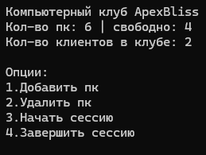

# 🖥️ ApexBliss


Консольная система учёта компьютерного клуба: компьютеры, клиенты и игровые сессии с атомарным изменением состояния через транзакции.




## Что умеет

- **Учёт компьютеров** — добавление (до 10 за раз) и удаление; занятый компьютер удалить нельзя.
- **Клиенты** — автоматическая регистрация клиента в момент, когда он садится за компьютер; клиент не может сидеть за двумя ПК одновременно.
- **Сессии** — начало сессии за свободным компьютером и завершение с фиксацией времени окончания.
- **Сводка в реальном времени** — всего компьютеров, свободно сейчас, клиентов в клубе, активные сессии.
- **Транзакции** — старт и завершение сессии атомарно меняют три таблицы (сессия, компьютер, клиент) и откатываются при любой ошибке.
- **Безопасный доступ к данным** — только параметризованные запросы (Dapper), без конкатенации SQL и без ORM.

---

## Стек

| Слой | Технологии |
| :-- | :-- |
| Язык и платформа | C# 14, .NET 10 |
| Доступ к данным | Dapper + `Microsoft.Data.SqlClient` |
| База данных | Microsoft SQL Server |
| Архитектура | Repository pattern, DI через конструктор, domain-модели + DTO |
| UI | Консольное меню |

---

## Архитектура

```
┌────────────────────────────────────┐
│  ComputerClub (консольное меню)    │
│  сводка, добавление ПК, сессии     │
└──────────────┬─────────────────────┘
               │  внедрение через конструктор
               ▼
┌────────────────────────────────────┐
│  IDBComputers / IDBClients         │
│  IDBSessions                       │
├────────────────────────────────────┤
│  SQLTableComputers                 │
│  SQLTableClients                   │
│  SQLTableSessions   → Dapper       │
└──────────────┬─────────────────────┘
               ▼
┌────────────────────────────────────┐
│  SQL Server (ComputerClub)         │
└────────────────────────────────────┘
```

**Как это устроено.** Класс `ComputerClub` отвечает за меню и сценарии, но ничего не знает про SQL: он работает через интерфейсы `IDBComputers`, `IDBClients`, `IDBSessions`. Их реализации (`SQLTable*`) инкапсулируют Dapper-запросы. Конкретные реализации создаются один раз в точке входа и передаются в конструктор.

**Доменные модели и DTO разделены.** Запросы возвращают лёгкие DTO (`ComputerDTO`, `ClientDTO`, `SessionDTO`) с полями как в БД, а наружу отдаются доменные объекты `Computer`, `Client`, `Session` с `private set` — изменить состояние можно только через методы репозитория.

**Результат операции — enum `Answer`.** Вместо исключений репозитории возвращают код: `Successfully`, `NameBusy`, `ComputerBusy`, `ClientAtComputer`, `NoneSession` и т.д. Меню показывает пользователю понятное сообщение на каждый случай.

**Статусы — enum, а не строки.** `Computer.Status` (`Free` / `Busy`) и `Client.Status` (`AtComputer` / `NotAtComputer`); преобразование между кодом и значением в БД выполняют `StatusString` и `StatusEnum`. Похожий приём позже перерос в отдельный слой кэша и валидации в [LibraryAPI](https://github.com/Escape-projects/LibraryAPI).

> Весь код лежит в одном файле `ComputerClub/Program.cs` — это осознанное решение для учебного проекта: видно весь путь от меню до SQL без переходов по папкам. В следующем проекте те же идеи разложены по слоям и проектам.

---

## Модель базы данных

| Таблица | Колонки |
| :-- | :-- |
| **Computers** | `computer_id` (PK, identity), `computer_name`, `computer_status` |
| **Clients** | `client_id` (PK, identity), `client_name`, `client_status` |
| **Sessions** | `session_id` (PK, identity), `computer_id` (FK), `client_id` (FK), `session_started_at`, `session_ended_at` (nullable) |

Ключевое ограничение предметной области — «один клиент за одним компьютером» — обеспечивается логикой: активной считается сессия с `session_ended_at IS NULL`, и запросы ищут занятость именно по ней.

---

## Как запустить

**Требования:** .NET 10 SDK, SQL Server (Express или Developer Edition).

1. Создайте базу `ComputerClub`.
2. Выполните скрипт `database/schema.sql` — он создаёт три таблицы, внешние ключи и значения по умолчанию. Проще всего открыть файл в SSMS и нажать **Execute**. Из командной строки:
   ```bash
   sqlcmd -S localhost -d ComputerClub -i database/schema.sql -f 65001
   ```
   Флаг `-f 65001` нужен, потому что файл в UTF-8: в нём есть русские значения по умолчанию (`'свободен'`, `'не за пк'`).
3. Проверьте строку подключения в начале `ComputerClub/ComputerClub/Program.cs` — она задана в коде:
   ```csharp
   string connectionString = @"Data Source=localhost;Initial Catalog=ComputerClub;Integrated Security=True;TrustServerCertificate=True";
   ```
4. Запустите приложение:
   ```bash
   dotnet run --project ComputerClub/ComputerClub
   ```

В меню: `1` — добавить ПК, `2` — удалить, `3` — начать сессию, `4` — завершить, `выход` — закрыть.

---

## Принятые решения

| Решение | Почему так | Альтернатива |
| :-- | :-- | :-- |
| **Dapper**, а не EF Core | Учебная цель — понять, что происходит под ORM: SQL пишется руками, маппинг явный | EF Core (используется в LibraryAPI) |
| **Repository pattern + интерфейсы** | Меню не зависит от SQL; реализации можно заменить | Прямые запросы из UI |
| **`enum Answer` вместо исключений** | Ожидаемые бизнес-ситуации («имя занято», «ПК занят») — не авария, а результат, который надо показать пользователю | Исключения + обработка в UI |
| **Транзакции в Start/End** | Состояние сессии, компьютера и клиента должно меняться вместе, иначе данные разъедутся | Три отдельных `UPDATE` без транзакции |
| **Консольный UI** | Фокус на доступе к данным и транзакциях, а не на интерфейсе | WinForms |

---

## Ограничения

- **Строка подключения задана в коде.** Для учебного проекта это допустимо; в рабочем коде она выносится в конфигурацию или переменные окружения.
- **Схема БД не проверяется на уровне приложения** — нет миграций, таблицы создаются скриптом.
- **Нет тестов** — логика проверялась вручную; в следующем проекте появились 52 юнит-теста.

---

## Контакты

- GitHub: [@escape-re](https://github.com/escape-re)
- Telegram: [@escape_137](https://t.me/escape_137)
- Email: Denny2002@list.ru
